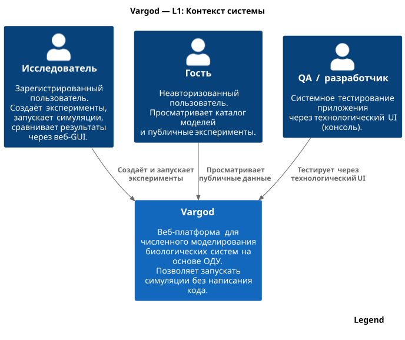
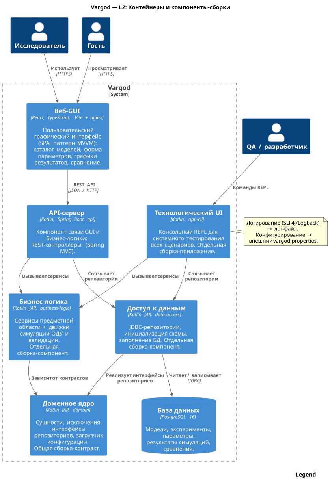
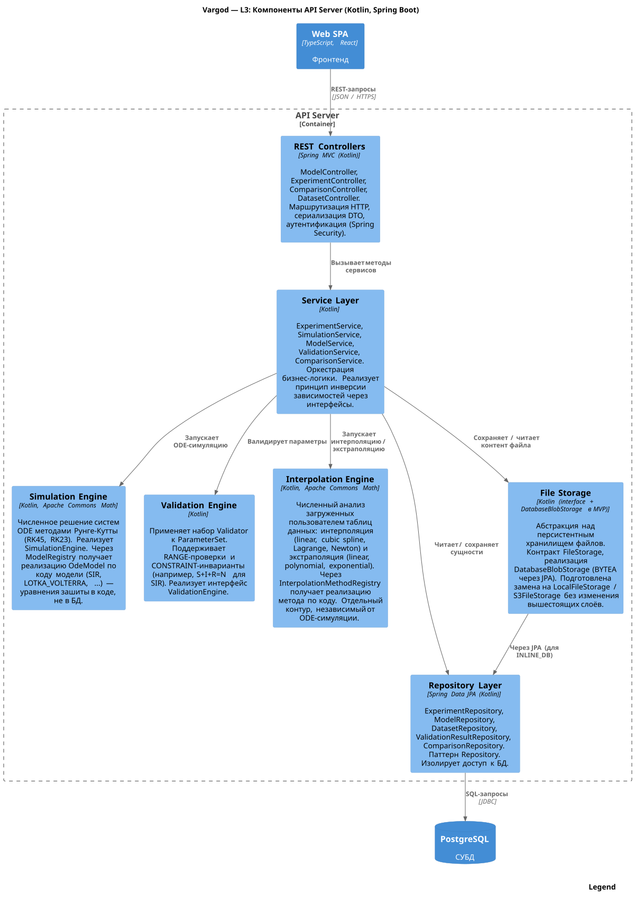
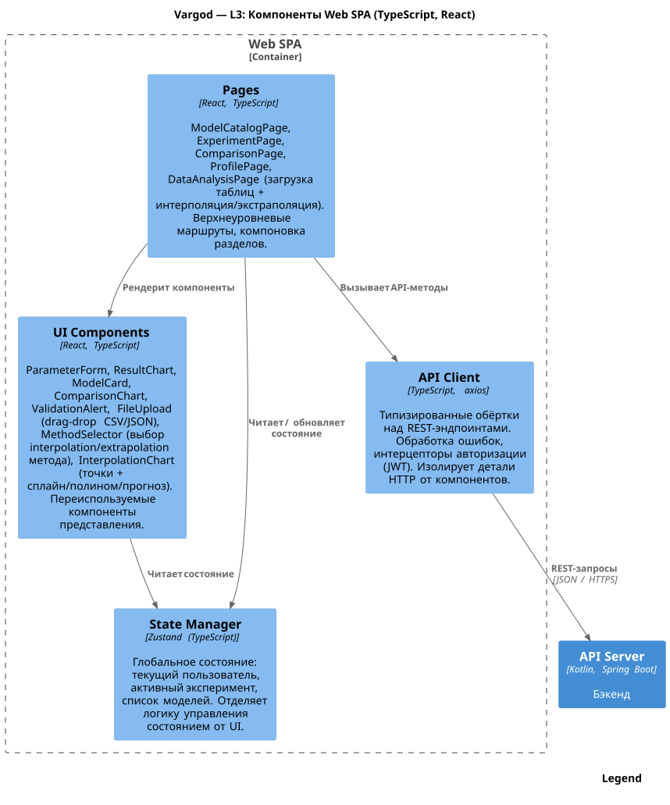
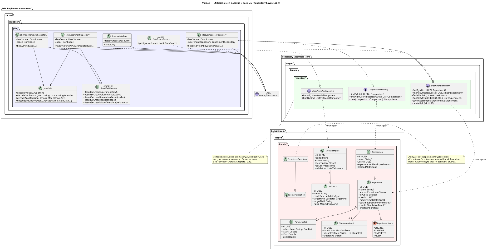
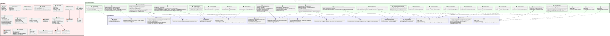
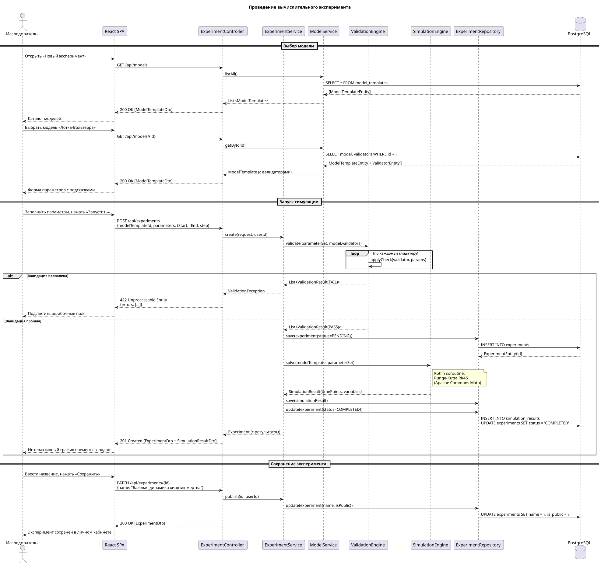
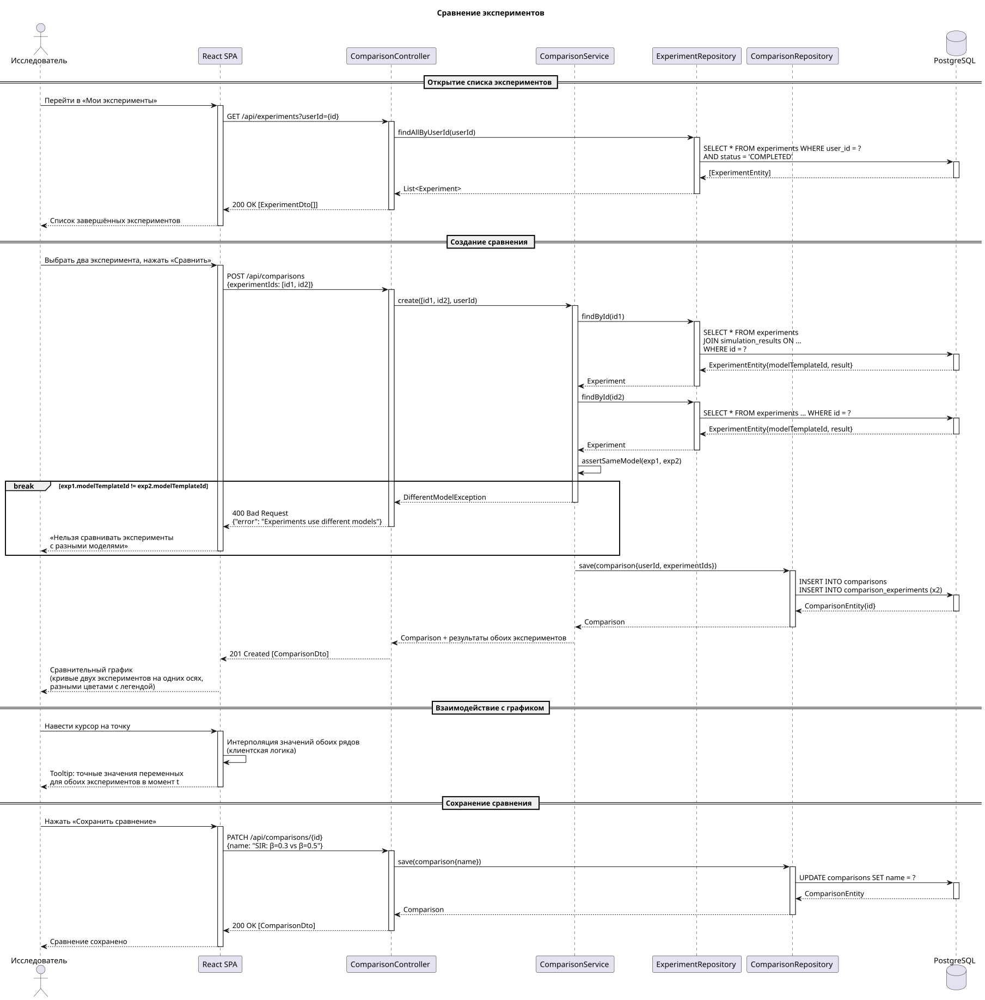
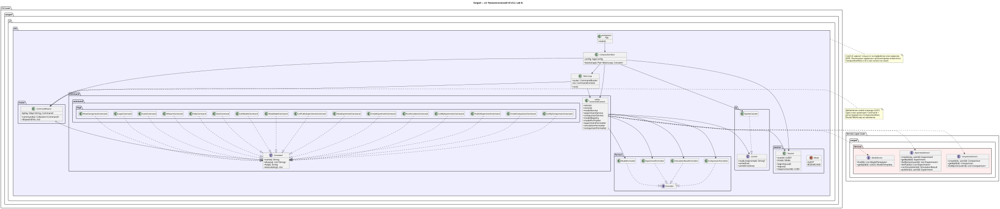

# Vargod — Платформа биологического математического моделирования

## Описание проекта

Vargod — это веб-платформа для проведения вычислительных экспериментов на основе классических математических моделей биологических систем. Пользователь выбирает модель (в мвп модели основанные только на ОДУ, архитектурно будет реализована возможность добавления моделей на основе других методов, например стохастика), задаёт начальные условия и параметры, запускает симуляцию и получает интерактивный график временных рядов. Платформа предназначена для исследователей, студентов и преподавателей, которым нужен быстрый инструмент для численного эксперимента без необходимости писать код.

## Предметная область

Предметная область — вычислительная биология и математическое моделирование динамических систем. Основные сущности: **математическая модель** (система дифференциальных уравнений с описанием и параметрами), **эксперимент** (конкретный запуск модели с выбранным набором параметров), **набор параметров** (начальные условия и коэффициенты симуляции), **результат симуляции** (временны́е ряды переменных модели), **пользователь** (исследователь, создающий эксперименты), **сравнение** (совместный анализ нескольких экспериментов на одном графике).

## Анализ аналогичных решений

| Критерий | NetLogo | COPASI | Wolfram Alpha | Vargod |
|---|---|---|---|---|
| **Веб-доступ без установки** | Частично (web-версия ограничена) | Нет (только desktop) | Да | Да |
| **Фокус на биологических ODE-моделях** | Агент-ориентированный, не ODE | Да, но сложный интерфейс | Общая математика | Да, специализированный |
| **Сравнение нескольких экспериментов** | Нет | Да, но громоздко | Нет | Да, нативно |
| **Низкий порог вхождения (без кода)** | Требует скрипты NetLogo | Требует настройку SBML | Да | Да |
| **Открытый исходный код / бесплатность** | Бесплатно | Бесплатно | Платно | Бесплатно (open source) |

**Обоснование критериев:** веб-доступ критичен для воспроизводимости и совместной работы; фокус на ODE-моделях отличает от агент-ориентированных систем; сравнение экспериментов — ключевая исследовательская задача, которую большинство аналогов решают неудобно.

## Актуальность и целесообразность

Математическое моделирование биологических процессов активно используется в эпидемиологии, экологии и биофизике, однако существующие инструменты либо требуют установки специализированного ПО, либо предполагают глубокие технические знания. Vargod закрывает нишу лёгкого веб-инструмента, ориентированного на быстрый численный эксперимент с классическими моделями: SIR/SEIR, Лотка-Вольтерра, логистический рост и другими.

## Акторы (роли)

**Гость** — неавторизованный пользователь. Может просматривать каталог математических моделей с описаниями и формулами, а также публичные эксперименты других исследователей. Не может создавать и запускать эксперименты.

**Исследователь** — зарегистрированный и авторизованный пользователь. Может создавать эксперименты, настраивать параметры, запускать симуляции, просматривать и сохранять результаты, сравнивать несколько экспериментов между собой, а также публиковать эксперименты в общий доступ.

## Use-Case диаграмма


## ER-диаграмма


## Пользовательские сценарии

### Сценарий 1. Гость знакомится с платформой

**Актор:** Гость  
**Предусловие:** пользователь не авторизован, открыл главную страницу  

| Шаг | Действие пользователя | Реакция системы |
|---|---|---|
| 1 | Открывает главную страницу | Отображает список доступных математических моделей (SIR, Лотка-Вольтерра, логистический рост и др.) |
| 2 | Нажимает на карточку модели «SIR-модель эпидемии» | Отображает страницу модели: описание, система уравнений, список параметров с пояснениями |
| 3 | Нажимает «Публичные эксперименты» | Отображает список экспериментов, опубликованных исследователями |
| 4 | Выбирает один из публичных экспериментов | Отображает параметры и график результатов эксперимента |
| 5 | Нажимает «Войти / Зарегистрироваться» | Перенаправляет на форму регистрации/входа |

---

### Сценарий 2. Исследователь проводит симуляцию модели Лотки-Вольтерра

**Актор:** Исследователь  
**Предусловие:** пользователь авторизован  

| Шаг | Действие пользователя | Реакция системы |
|---|---|---|
| 1 | Переходит в раздел «Новый эксперимент» | Отображает каталог моделей |
| 2 | Выбирает модель «Лотка-Вольтерра (хищник-жертва)» | Отображает форму с параметрами: начальные популяции, коэффициенты роста и хищничества |
| 3 | Вводит: жертвы=100, хищники=20, α=1.0, β=0.1, γ=1.5, δ=0.075, t=[0, 50] | — |
| 4 | Нажимает «Запустить симуляцию» | Валидирует параметры; все параметры корректны |
| 5 | — | Запускает численное решение ОДУ, устанавливает статус «running» |
| 6 | Ожидает завершения | Сохраняет временные ряды, устанавливает статус «completed», отображает интерактивный график двух кривых |
| 7 | Вводит название «Базовая динамика хищник-жертва» и нажимает «Сохранить» | Сохраняет эксперимент в личном кабинете исследователя |

---

### Сценарий 3. Исследователь сравнивает два эксперимента с разными параметрами

**Актор:** Исследователь  
**Предусловие:** у исследователя есть минимум два завершённых эксперимента с одной моделью  

| Шаг | Действие пользователя | Реакция системы |
|---|---|---|
| 1 | Переходит в «Мои эксперименты» | Отображает список сохранённых экспериментов |
| 2 | Выбирает два эксперимента с моделью SIR и нажимает «Сравнить» | Проверяет, что оба эксперимента используют одну модель |
| 3 | — | Строит сравнительный график: кривые обоих экспериментов на одних осях, разными цветами с легендой |
| 4 | Наводит курсор на точку графика | Отображает tooltip с точными значениями переменных в данный момент времени для обоих экспериментов |
| 5 | Нажимает «Сохранить сравнение» | Сохраняет сравнение с возможностью вернуться к нему позже |

## Бизнес-процессы (BPMN)
### Процесс 1. Проведение вычислительного эксперимента

---
### Процесс 2. Сравнение экспериментов


---

# Лабораторная работа № 2 — Проектирование. UML и C4

## 1. Тип приложения и технологический стек

**Тип приложения:** Web SPA (Single Page Application).

Пользователь работает в браузере, переходы между разделами (каталог моделей, форма эксперимента, график результатов, сравнение, анализ данных) реализованы через клиентский роутинг.

| Слой | Технология |
|---|---|
| **Frontend** | TypeScript, React, Zustand |
| **Backend** | Kotlin, Spring Boot |
| **ODE-симуляция** | Apache Commons Math (Kotlin) | 
| **СУБД** | PostgreSQL | 
| **ORM / доступ к БД** | Spring Data JPA (Hibernate) |

## 2. Нотация C4 — уровни L1 и L2

### L1 — Контекст системы

Система взаимодействует с двумя типами пользователей: Исследователь (авторизован, создаёт эксперименты) и Гость (просматривает публичные данные).



### L2 — Контейнеры




## 3. Нотация C4 — уровень L3 (компоненты)

### Backend

Четыре компонента, разделённых по зонам ответственности:

- **REST Controllers** — маршрутизация HTTP, сериализация DTO, Spring Security.
- **Service Layer** — оркестрация бизнес-логики. Контроллеры и сервисы зависят от интерфейсов, что позволяет заменить реализацию (например, другой ODE-солвер или объектное хранилище S3 вместо инлайн-блобов в БД) без изменения вышестоящих слоёв.
- **Simulation Engine** — численное моделирование.
- **Validation Engine** — валидирует параметры.
- **Interpolation Engine** — численный анализ загруженных датасетов.
- **Repository Layer** — Spring Data JPA-репозитории. Изолируют доступ к БД от бизнес-логики.
- **File Storage** — абстракция над хранилищем файлов. 



### Frontend (TypeScript, React)



## 4. Нотация C4 — уровень L4 (код, UML-диаграммы классов)

### Компонент доступа к данным (Repository Layer)



### Компонент бизнес-логики (Service Layer)



## 5. Диаграммы последовательностей (UML Sequence)

### Процесс 1. Проведение вычислительного эксперимента



### Процесс 2. Сравнение экспериментов



## 6. Схема БД (DBML)


СУБД: **PostgreSQL**. Схема включает 11 таблиц:

| Таблица | Назначение |
|---|---|
| `users` | Пользователи |
| `model_templates` | Каталог моделей|
| `datasets` | Загруженные файлы данных  |
| `validators` | Правила валидации |
| `experiments` | Эксперименты пользователя |
| `parameter_sets` | Набор параметров эксперимента (коэффициенты ODE, временной диапазон) |
| `simulation_results` | Временные ряды — результат ODE-симуляции (JSONB) |
| `validation_results` | Результаты применения валидаторов к набору параметров |
| `comparisons` | Сравнения нескольких экспериментов |
| `comparison_experiments` | M:N между сравнением и экспериментами |
| `interpolations` | Запросы интерполяции/экстраполяции по загруженной таблице |

### Каталог правил валидации


#### `check_type = RANGE` — числовая граница

| Параметр | Тип | Обяз. | Описание |
|---|---|---|---|
| `min` | number | нет | нижняя граница |
| `max` | number | нет | верхняя граница |
| `minExclusive` | boolean | нет, default `false` | если `true` — строгая `>` вместо `≥` |
| `maxExclusive` | boolean | нет, default `false` | если `true` — строгая `<` вместо `≤` |

Хотя бы один из `min` / `max` должен быть указан. Применимо к `target_kind`: `PARAMETER`, `DATASET_COLUMN`.

Примеры:
```json
{"min": 0, "max": 1}
{"min": 0, "minExclusive": true}
{"max": 100}
{"min": -1, "max": 1, "maxExclusive": true}
```

#### `check_type = CONSTRAINT` — инвариант над несколькими значениями


| `type` | Класс | Параметры | Семантика | Применимо к |
|---|---|---|---|---|
| `SUM_EQUALS_VALUE` | `SumEqualsValueRule` | `fields: List<String>`, `expected: Number`, `tolerance?: Number` | Σ значений полей == `expected` (±`tolerance`, default 1e-9) | PARAMETER |
| `SUM_EQUALS_FIELD` | `SumEqualsFieldRule` | `fields: List<String>`, `expectedField: String`, `tolerance?: Number` | Σ значений полей == значение поля `expectedField` | PARAMETER |
| `ORDERED` | `OrderedRule` | `fields: List<String>`, `direction: ASCENDING \| DESCENDING` | Значения перечисленных полей строго отсортированы | PARAMETER, DATASET_COLUMN |

Примеры:
```json
{"type": "SUM_EQUALS_VALUE",
 "fields": ["S","I","R"],
 "expected": 1000.0}

{"type": "SUM_EQUALS_FIELD",
 "fields": ["S","I","R"],
 "expectedField": "N"}

{"type": "ORDERED",
 "fields": ["t1","t2","t3"],
 "direction": "ASCENDING"}
```

---

# Лабораторная работа № 3 — Бизнес-логика

## 1. Объём реализации

Реализован компонент **Service Layer** из L4-диаграммы. Покрыты **3 сервиса из 6**: `ExperimentService`, `ModelService`, `ComparisonService`. 
| Слой | Реализация |
|---|---|---|
| Сервисы | `ExperimentServiceImpl`, `ModelServiceImpl`, `ComparisonServiceImpl` |
| Движок симуляции | `OdeSimulationEngine` (Apache Commons Math RK45) | 
| ODE-модели | `SirModel`, `LotkaVolterraModel`, `LogisticGrowthModel` | 
| Движок валидации | `RuleValidationEngine` (RANGE + CONSTRAINT) | 
| Constraint-правила | `SumEqualsValueRule`, `SumEqualsFieldRule`, `OrderedRule` | 
| Реестры | `MapModelRegistry`, `MapConstraintRuleRegistry` | 

## 2. Структура `src/`

```
src/main/kotlin/com/vargod/
  domain/            Experiment, ParameterSet, ModelTemplate, SimulationResult,
                     Comparison, Validator, ValidationResult, exceptions
  domain/dto/        CreateExperimentRequest
  service/           ExperimentService, ModelService, ComparisonService (interfaces)
  service/impl/      *Impl
  engine/            SimulationEngine, ValidationEngine, OdeModel, ModelRegistry,
                     ConstraintRule, ConstraintRuleRegistry (interfaces)
  engine/ode/        SirModel, LotkaVolterraModel, LogisticGrowthModel,
                     OdeSimulationEngine, MapModelRegistry
  engine/validation/ SumEqualsValueRule, SumEqualsFieldRule, OrderedRule,
                     RuleValidationEngine, MapConstraintRuleRegistry
  domain/repository/ ExperimentRepository, ModelTemplateRepository,
                     ComparisonRepository (interfaces — после Lab 4 перенесены
                     в пакет домена, см. §3 примечания Lab 4)
  repository/jdbc/   JDBC-реализации интерфейсов (Lab 4)

src/test/kotlin/com/vargod/
  testfixtures/Fixtures.kt
  domain/DomainExceptionsTest.kt
  engine/ode/        тесты на SIR, Lotka-Volterra, Logistic, MapModelRegistry,
                     OdeSimulationEngine (сравнение с аналитическим решением)
  engine/validation/ тесты на каждое constraint-правило, RuleValidationEngine
                     (RANGE + CONSTRAINT через мок-реестр)
  service/impl/      ExperimentServiceImplTest, ModelServiceImplTest,
                     ComparisonServiceImplTest (моки на repositories и engines)
```

---

# Лабораторная работа № 4 — Доступ к данным

## 1. Объём реализации

JDBC-реализации трёх репозиторных интерфейсов + интеграционные тесты. ORM не
используется (§5 примечания): только пакет `java.sql.*` + JDBC-драйвер H2.
Jackson задействован исключительно для (де)сериализации JSON-полей в TEXT-
колонки — это сериализатор, а не ORM.

| Слой | Реализация |
|---|---|
| СУБД (прод и тесты) | PostgreSQL 16. Тесты поднимают реальный PostgreSQL через Testcontainers (`postgres:16-alpine`), используют тот же `DataSourceFactory.postgres(...)` и `SchemaInitializer`, что и прод. Это гарантирует, что интеграционные тесты проверяют именно тот код, который будет работать в production. Требование §6 (персистентность) удовлетворено самой природой PostgreSQL. |
| Зависимости тестов | `org.testcontainers:postgresql` + `org.testcontainers:junit-jupiter` |
| JDBC-реализации | `JdbcExperimentRepository`, `JdbcModelTemplateRepository`, `JdbcComparisonRepository` |
| Инфраструктура | `DataSourceFactory`, `SchemaInitializer`, `JsonCodec`, `ResultSetMappers` |
| DDL | `src/main/resources/db/schema.sql` (переносимый PG-flavor SQL) |
| Ошибки | `PersistenceException` — наследник `DomainException`, оборачивает `SQLException` |
| Интеграционные тесты | 6 шт.: 3 (Experiment) + 2 (Comparison) + 1 (ModelTemplate) — покрывают save/update/delete/retrieve |

## 2. Реализация принципов SOLID и §3

§3 примечания Lab 4: «компонент доступа к данным должен зависеть от
компонента бизнес-логики». Для буквального соблюдения этого требования
интерфейсы репозиториев перенесены в пакет домена `com.vargod.domain.repository`,
а JDBC-реализации — в `com.vargod.repository.jdbc`. Поток зависимостей:

```
service (business) → domain.repository (interfaces) ← repository.jdbc (impl)
                              ↘                              ↙
                                    domain (entities)
```

- **DIP**: бизнес-логика не знает о JDBC; реализация знает об интерфейсе и
  доменных типах.
- **SRP**: репозитории атомарны (по агрегату); миграции/JSON/маппинг ResultSet
  → отдельные классы.
- **OCP/LSP**: моки на интерфейсах в тестах Lab 3 продолжают работать без
  изменений; H2 заменим на PostgreSQL правкой одной строки в `DataSourceFactory`.
- **ISP**: интерфейсы узкие (5/3/2 методов).

## 3. Обработка ошибок и валидация

- **Pre-conditions** (валидация) в каждом методе `save`:
  непустые `parameterSet.values`, длина `name` ≤ 255, `tEnd > tStart`,
  `step > 0`, уникальные id экспериментов в `Comparison` и т. д.
- `SQLException` оборачивается в `PersistenceException` с сохранением
  `cause` — внешние слои оперируют только доменными ошибками.
- `findById` возвращает `null` (не бросает) — этот контракт сервисный слой
  Lab 3 ожидает (он сам кидает `NotFoundException`).
- Транзакции: `save(Experiment)` и `save(Comparison)` пишут в несколько
  таблиц атомарно (`autoCommit=false`, `commit`/`rollback`).
- Upsert вложенных сущностей выполняется по UNIQUE FK (`experiment_id` /
  `comparison_id`), не по их собственному PK — иначе повторный `save`
  с новым UUID-ребёнком упёрся бы в `UNIQUE` constraint.

## 4. C4 L4 — обновлённая диаграмма


## 5. Схема БД

`src/main/resources/db/schema.sql` — PostgreSQL DDL для семи таблиц,
относящихся к области ответственности трёх реализованных репозиториев:
`model_templates`, `validators`, `experiments`, `parameter_sets`,
`simulation_results`, `comparisons`, `comparison_experiments`. Остальные таблицы
из DBML (`users`, `datasets`, `validation_results`, `interpolations`) появятся
с соответствующими репозиториями в следующих итерациях.

Отличия от DBML, релевантные текущей реализации:
- В `comparison_experiments` добавлена колонка `position INT NOT NULL` —
  домен описывает связь как `List<Experiment>` (упорядоченную), `position`
  гарантирует стабильный порядок чтения через `ORDER BY position`.
- Колонка `parameter_sets.values` квотирована (`"values"`) — для совместимости
  с строгими SQL-парсерами (`VALUES` — зарезервированное слово в стандарте SQL).
- FK на ещё не существующую таблицу `users` опущены (только тип `UUID NOT NULL`).

## 6. Интеграционные тесты

`src/test/kotlin/com/vargod/repository/jdbc/`:

| Тест-класс | Кол-во | Сценарии |
|---|---|---|
| `JdbcExperimentRepositoryIT` | 3 | save+findById; повторный save с обновлением статуса и добавлением результата; deleteById с CASCADE |
| `JdbcComparisonRepositoryIT` | 2 | save M:N с сохранением порядка; findAllByUserId фильтрует по пользователю |
| `JdbcModelTemplateRepositoryIT` | 1 | findAll + findById (hit/miss) + загрузка валидаторов |

`JdbcRepositoryTestBase` — общая инфраструктура: переиспользует синглтон-
контейнер PostgreSQL (`TestPostgres`), запускаемый Testcontainers один раз
на тестовый JVM. `schema.sql` накатывается единожды; между тестами выполняется
`TRUNCATE … CASCADE` для изоляции состояния. Контейнер останавливается через
JVM shutdown hook.

**Предусловие запуска тестов**: на машине должен работать Docker
(Docker Desktop / OrbStack / Colima). Testcontainers сам подтянет образ
`postgres:16-alpine` при первом запуске.

## 7. Структура `src/` (дополнение)

```
src/main/kotlin/com/vargod/
  domain/repository/    ExperimentRepository, ModelTemplateRepository,
                        ComparisonRepository (интерфейсы)
  domain/exceptions.kt  + PersistenceException
  repository/jdbc/      DataSourceFactory, SchemaInitializer, JsonCodec,
                        ResultSetMappers,
                        JdbcExperimentRepository, JdbcModelTemplateRepository,
                        JdbcComparisonRepository

src/main/resources/db/  schema.sql

src/test/kotlin/com/vargod/repository/jdbc/
  JdbcRepositoryTestBase.kt
  JdbcExperimentRepositoryIT.kt
  JdbcComparisonRepositoryIT.kt
  JdbcModelTemplateRepositoryIT.kt
```

## 8. Запуск

```bash
./gradlew test
./gradlew jacocoTestReport
```

Регенерация диаграмм (если установлен `plantuml`):

```bash
plantuml -tsvg diagrams/c4_l4_repository.puml -o ../img
```

---

# Лабораторная работа № 5 — Технологический UI

## 1. Объём реализации

Реализован **технологический CLI** (`com.vargod.ui.cli`) для системного тестирования
приложения: интерактивный REPL поверх существующих сервис-интерфейсов
(`ModelService`, `ExperimentService`, `ComparisonService`). UI зависит **только** от
сервисных интерфейсов и доменных типов — конкретные JDBC-репозитории и движки
инжектятся `CompositionRoot` и UI о них ничего не знает (DIP).

Также добавлено:
- application-plugin в `build.gradle.kts` (точка входа `com.vargod.ui.cli.AppKt`);
- `DataSeeder` — идемпотентный сид трёх ODE-моделей (SIR, LOTKA_VOLTERRA, LOGISTIC)
  с RANGE-валидаторами + CONSTRAINT (`SUM_EQUALS_FIELD` для `S+I+R=N` у SIR);
- `Dockerfile` + `docker-compose.yml` для запуска одной командой.

## 2. Покрытие Use Case

| Команда | Use Case (из ТЗ / сценариев в README) | Метод сервиса |
|---|---|---|
| `models` | Каталог моделей (Гость, Иссл.) | `ModelService.listAll()` |
| `model <code\|id>` | Детальная страница модели (формулы, валидаторы) | `ModelService.getById()` |
| `public` | Список публичных экспериментов (Гость, Иссл.) | `ExperimentService.listPublic()` |
| `exp <id>` | Просмотр эксперимента + превью результата | `ExperimentService.getById()` |
| `new-exp` | Создать эксперимент (интерактивно собирает параметры под модель) | `ExperimentService.create()` |
| `run <id>` | Запустить симуляцию | `ExperimentService.runSimulation()` |
| `my-exps` | Мои эксперименты | `ExperimentService.listByUser()` |
| `publish <id>` | Опубликовать эксперимент | `ExperimentService.publish()` |
| `new-cmp <id1> <id2> [...]` | Создать сравнение | `ComparisonService.create()` |
| `my-cmps` | Мои сравнения | `ComparisonService.listByUser()` |
| `cmp <id>` | Показать сравнение | `ComparisonService.getById()` |
| `login [uuid]` / `guest` / `whoami` | Переключение ролей Гость↔Исследователь | локальное состояние сессии |
| `help` / `quit` | служебные | — |

Все методы трёх сервисных интерфейсов покрыты.

## 3. Архитектура и SOLID



- **DIP.** `CommandContext` инжектит `ModelService`/`ExperimentService`/`ComparisonService` —
  только интерфейсы. Ввод/вывод абстрагирован интерфейсом `Console` (реализация
  `SystemConsole`). Реализации сервисов и репозиториев приходят из `CompositionRoot`,
  UI о них не знает.
- **OCP.** Добавление новой команды = новый класс реализует `Command` +
  регистрация в `CompositionRoot`. Роутер и главный цикл не меняются.
- **SRP.** `Console` — только I/O; `Formatter<T>` — только рендеринг;
  `Command` — один сценарий Use Case; `CommandRouter` — только диспетчеризация;
  `Session` — только состояние актора; `DataSeeder` — только сид моделей.
- **ISP.** `Command` — узкий интерфейс (4 метода); `Formatter<T>` параметризован.
- **LSP.** Все команды взаимозаменяемы через `Map<String, Command>`; контракт
  `execute(args, ctx)` единый.

## 4. Обновлённая L2-диаграмма


Технологический CLI (`Kotlin`) добавлен рядом с будущим Web SPA. Оба контейнера
обращаются к одному и тому же компоненту бизнес-логики (Service Layer из Lab 3),
что и требуется ТЗ: «технологический UI должен работать с тем же компонентом
бизнес-логики, с которым позже будет работать полноценный GUI».

## 5. Запуск

### Через Docker (рекомендуется)

```bash
docker compose run --rm app
```

Эта команда:
1. Поднимает PostgreSQL 16 в контейнере `db` с healthcheck;
2. Собирает образ приложения (multi-stage Dockerfile);
3. Запускает интерактивный REPL — `vargod [guest]> `.

Том `vargod-db` сохраняет состояние БД между запусками.

### Локально (без Docker)

Требуется работающий PostgreSQL:

```bash
export DB_URL=jdbc:postgresql://localhost:5432/vargod
export DB_USER=vargod
export DB_PASSWORD=vargod
./gradlew run -q --console=plain
```

## 6. Пример сессии (системное тестирование)

```
vargod [guest]> models
  [1] LOGISTIC           — Логистический рост
  [2] LOTKA_VOLTERRA     — Lotka-Volterra — хищник-жертва
  [3] SIR                — SIR — модель эпидемии

vargod [guest]> model SIR
Model SIR
  id          : ...
  variables   : S, I, R
  parameters  : beta, gamma, N
  validators  :
    - range[beta] [RANGE]        ...
    - S+I+R=N    [CONSTRAINT(SUM_EQUALS_FIELD)] ...

vargod [guest]> login
→ logged in as researcher; userId=ab12...

vargod [researcher]> new-exp
Model code (e.g. SIR, LOTKA_VOLTERRA, LOGISTIC): SIR
  param S (initial value): 990
  param I (initial value): 10
  param R (initial value): 0
  param beta: 0.4
  param gamma: 0.1
  param N: 1000
  tStart: 0
  tEnd  : 60
  step  : 0.5
  name (optional, blank = none): epidemic-base
→ created experiment cd34...; status=PENDING

vargod [researcher]> run cd34...
→ simulation completed for cd34...
  points: 121; result id=...
  t           S           I           R
  ------------------------------------------------
  0.0000      990.0000    10.0000     0.0000
  0.5000      988.0...    11.9...     0.0...
  …
```

## 7. Системное тестирование — чек-лист

Минимальный путь, проверяющий все Use Case:

1. `models` — каталог (UC: список моделей);
2. `model SIR` — деталь модели (UC: формулы/валидаторы);
3. `login` → `new-exp` (SIR, валидные параметры) — UC: создание эксперимента;
4. `my-exps` — UC: мои эксперименты;
5. `run <id>` — UC: запуск симуляции (с превью результата);
6. `exp <id>` — UC: просмотр эксперимента;
7. `publish <id>` — UC: публикация;
8. `guest` → `public` — UC: гостевой просмотр публичных;
9. `login <тот-же-uuid>` → второй `new-exp` + `run` той же SIR;
10. `new-cmp <id1> <id2>` — UC: создание сравнения;
11. `my-cmps`, `cmp <id>` — UC: список и деталь сравнения.

**Негативные сценарии (тоже покрываются UI):**
- `new-exp` с `S+I+R ≠ N` → `ValidationException` (CONSTRAINT);
- `new-exp` с `beta=-1` → `ValidationException` (RANGE);
- `publish` чужого эксперимента → `AuthorizationException`;
- `new-cmp` экспериментов разных моделей → ошибка про «same model»;
- `run` для уже COMPLETED → `IllegalExperimentStateException`;
- неизвестный UUID → `NotFoundException`.

Все ошибки отображаются через `Console.writeError` без падения REPL.

## 8. Структура `src/`

```
src/main/kotlin/com/vargod/ui/cli/
  App.kt                          точка входа (mainClass)
  CompositionRoot.kt              DI-граф: DataSource → repo → engine → service → команды
  MainLoop.kt                     REPL + обработка DomainException
  io/Console.kt, SystemConsole.kt абстракция I/O
  session/Session.kt              userId + Mode(GUEST|RESEARCHER)
  command/Command.kt, CommandContext.kt, QuitSignal.kt
  command/impl/*.kt               16 команд (12 Use Case + login/guest/whoami/help/quit)
  router/CommandRouter.kt         Map<String, Command>, диспетчеризация
  format/Formatter.kt + 4 реализации (Model/Experiment/Simulation/Comparison)
  bootstrap/DataSeeder.kt         INSERT 3 ModelTemplate + валидаторы (идемпотентно)
```

## 9. Регенерация L4-диаграммы

```bash
plantuml -tsvg diagrams/c4_l4_cli.puml -o ../img
plantuml -tsvg diagrams/c4_l2_container.puml -o ../img
```
