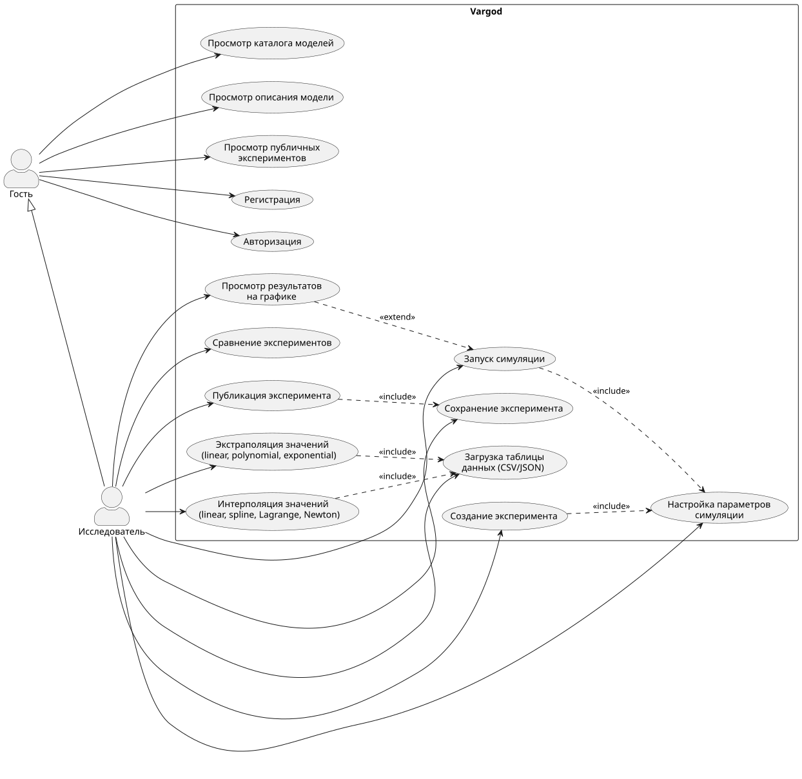
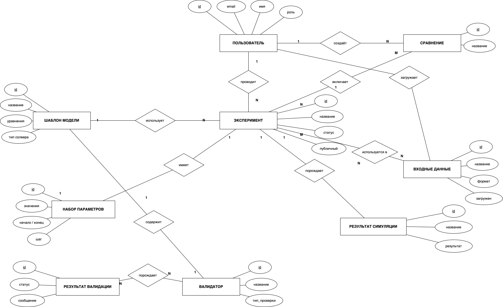

# Vargod — Платформа биологического математического моделирования

## Описание проекта

Vargod — это веб-платформа для проведения вычислительных экспериментов на основе классических математических моделей биологических систем. Пользователь выбирает модель (в мвп модели основанные только на ОДУ, архитектурно будет реализована возможность добавления моделей на основе других методов, например стохастика), задаёт начальные условия и параметры, запускает симуляцию и получает интерактивный график временных рядов. Платформа предназначена для исследователей, студентов и преподавателей, которым нужен быстрый инструмент для численного эксперимента без необходимости писать код.

## Предметная область

Предметная область — вычислительная биология и математическое моделирование динамических систем. Основные сущности: **математическая модель** (система дифференциальных уравнений с описанием и параметрами), **эксперимент** (конкретный запуск модели с выбранным набором параметров), **набор параметров** (начальные условия и коэффициенты симуляции), **результат симуляции** (временны́е ряды переменных модели), **пользователь** (исследователь, создающий эксперименты), **сравнение** (совместный анализ нескольких экспериментов на одном графике).

## Анализ аналогичных решений

| Критерий | NetLogo | COPASI | Wolfram Alpha | Vargod |
|---|---|---|---|---|
| **Веб-доступ без установки** | Частично (web-версия ограничена) | Нет (только desktop) | Да | Да |
| **Фокус на биологических ODE-моделях** | Агент-ориентированный, не ODE | Да, но сложный интерфейс | Общая математика | Да, специализированный |
| **Сравнение нескольких экспериментов** | Нет | Да, но громоздко | Нет | Да, нативно |
| **Низкий порог вхождения (без кода)** | Требует скрипты NetLogo | Требует настройку SBML | Да | Да |
| **Открытый исходный код / бесплатность** | Бесплатно | Бесплатно | Платно | Бесплатно (open source) |

**Обоснование критериев:** веб-доступ критичен для воспроизводимости и совместной работы; фокус на ODE-моделях отличает от агент-ориентированных систем; сравнение экспериментов — ключевая исследовательская задача, которую большинство аналогов решают неудобно.

## Актуальность и целесообразность

Математическое моделирование биологических процессов активно используется в эпидемиологии, экологии и биофизике, однако существующие инструменты либо требуют установки специализированного ПО, либо предполагают глубокие технические знания. Vargod закрывает нишу лёгкого веб-инструмента, ориентированного на быстрый численный эксперимент с классическими моделями: SIR/SEIR, Лотка-Вольтерра, логистический рост и другими.

## Акторы (роли)

**Гость** — неавторизованный пользователь. Может просматривать каталог математических моделей с описаниями и формулами, а также публичные эксперименты других исследователей. Не может создавать и запускать эксперименты.

**Исследователь** — зарегистрированный и авторизованный пользователь. Может создавать эксперименты, настраивать параметры, запускать симуляции, просматривать и сохранять результаты, сравнивать несколько экспериментов между собой, а также публиковать эксперименты в общий доступ.

## Use-Case диаграмма




## ER-диаграмма




## Пользовательские сценарии

### Сценарий 1. Гость знакомится с платформой

**Актор:** Гость  
**Предусловие:** пользователь не авторизован, открыл главную страницу  

| Шаг | Действие пользователя | Реакция системы |
|---|---|---|
| 1 | Открывает главную страницу | Отображает список доступных математических моделей (SIR, Лотка-Вольтерра, логистический рост и др.) |
| 2 | Нажимает на карточку модели «SIR-модель эпидемии» | Отображает страницу модели: описание, система уравнений, список параметров с пояснениями |
| 3 | Нажимает «Публичные эксперименты» | Отображает список экспериментов, опубликованных исследователями |
| 4 | Выбирает один из публичных экспериментов | Отображает параметры и график результатов эксперимента |
| 5 | Нажимает «Войти / Зарегистрироваться» | Перенаправляет на форму регистрации/входа |

---

### Сценарий 2. Исследователь проводит симуляцию модели Лотки-Вольтерра

**Актор:** Исследователь  
**Предусловие:** пользователь авторизован  

| Шаг | Действие пользователя | Реакция системы |
|---|---|---|
| 1 | Переходит в раздел «Новый эксперимент» | Отображает каталог моделей |
| 2 | Выбирает модель «Лотка-Вольтерра (хищник-жертва)» | Отображает форму с параметрами: начальные популяции, коэффициенты роста и хищничества |
| 3 | Вводит: жертвы=100, хищники=20, α=1.0, β=0.1, γ=1.5, δ=0.075, t=[0, 50] | — |
| 4 | Нажимает «Запустить симуляцию» | Валидирует параметры; все параметры корректны |
| 5 | — | Запускает численное решение ОДУ, устанавливает статус «running» |
| 6 | Ожидает завершения | Сохраняет временные ряды, устанавливает статус «completed», отображает интерактивный график двух кривых |
| 7 | Вводит название «Базовая динамика хищник-жертва» и нажимает «Сохранить» | Сохраняет эксперимент в личном кабинете исследователя |

---

### Сценарий 3. Исследователь сравнивает два эксперимента с разными параметрами

**Актор:** Исследователь  
**Предусловие:** у исследователя есть минимум два завершённых эксперимента с одной моделью  

| Шаг | Действие пользователя | Реакция системы |
|---|---|---|
| 1 | Переходит в «Мои эксперименты» | Отображает список сохранённых экспериментов |
| 2 | Выбирает два эксперимента с моделью SIR и нажимает «Сравнить» | Проверяет, что оба эксперимента используют одну модель |
| 3 | — | Строит сравнительный график: кривые обоих экспериментов на одних осях, разными цветами с легендой |
| 4 | Наводит курсор на точку графика | Отображает tooltip с точными значениями переменных в данный момент времени для обоих экспериментов |
| 5 | Нажимает «Сохранить сравнение» | Сохраняет сравнение с возможностью вернуться к нему позже |

## Бизнес-процессы (BPMN)
### Процесс 1. Проведение вычислительного эксперимента

---
### Процесс 2. Сравнение экспериментов


---

# Лабораторная работа № 2 — Проектирование. UML и C4

## 1. Тип приложения и технологический стек

**Тип приложения:** Web SPA (Single Page Application).

Пользователь работает в браузере, переходы между разделами (каталог моделей, форма эксперимента, график результатов, сравнение, анализ данных) реализованы через клиентский роутинг.

| Слой | Технология |
|---|---|
| **Frontend** | TypeScript, React, Zustand |
| **Backend** | Kotlin, Spring Boot |
| **ODE-симуляция** | Apache Commons Math (Kotlin) | 
| **СУБД** | PostgreSQL | 
| **ORM / доступ к БД** | Spring Data JPA (Hibernate) |

## 2. Нотация C4 — уровни L1 и L2

### L1 — Контекст системы

Система взаимодействует с двумя типами пользователей: Исследователь (авторизован, создаёт эксперименты) и Гость (просматривает публичные данные).


### L2 — Контейнеры


## 3. Нотация C4 — уровень L3 (компоненты)

### Backend

Четыре компонента, разделённых по зонам ответственности:

- **REST Controllers** — маршрутизация HTTP, сериализация DTO, Spring Security.
- **Service Layer** — оркестрация бизнес-логики. Контроллеры и сервисы зависят от интерфейсов, что позволяет заменить реализацию (например, другой ODE-солвер или объектное хранилище S3 вместо инлайн-блобов в БД) без изменения вышестоящих слоёв.
- **Simulation Engine** — численное моделирование.
- **Validation Engine** — валидирует параметры.
- **Interpolation Engine** — численный анализ загруженных датасетов.
- **Repository Layer** — Spring Data JPA-репозитории. Изолируют доступ к БД от бизнес-логики.
- **File Storage** — абстракция над хранилищем файлов. 


### Frontend (TypeScript, React)


## 4. Нотация C4 — уровень L4 (код, UML-диаграммы классов)

### Компонент доступа к данным (Repository Layer)


### Компонент бизнес-логики (Service Layer)


## 5. Диаграммы последовательностей (UML Sequence)

### Процесс 1. Проведение вычислительного эксперимента


### Процесс 2. Сравнение экспериментов


## 6. Схема БД (DBML)


СУБД: **PostgreSQL**. Схема включает 11 таблиц:

| Таблица | Назначение |
|---|---|
| `users` | Пользователи |
| `model_templates` | Каталог моделей|
| `datasets` | Загруженные файлы данных  |
| `validators` | Правила валидации |
| `experiments` | Эксперименты пользователя |
| `parameter_sets` | Набор параметров эксперимента (коэффициенты ODE, временной диапазон) |
| `simulation_results` | Временные ряды — результат ODE-симуляции (JSONB) |
| `validation_results` | Результаты применения валидаторов к набору параметров |
| `comparisons` | Сравнения нескольких экспериментов |
| `comparison_experiments` | M:N между сравнением и экспериментами |
| `interpolations` | Запросы интерполяции/экстраполяции по загруженной таблице |

### Каталог правил валидации


#### `check_type = RANGE` — числовая граница

| Параметр | Тип | Обяз. | Описание |
|---|---|---|---|
| `min` | number | нет | нижняя граница |
| `max` | number | нет | верхняя граница |
| `minExclusive` | boolean | нет, default `false` | если `true` — строгая `>` вместо `≥` |
| `maxExclusive` | boolean | нет, default `false` | если `true` — строгая `<` вместо `≤` |

Хотя бы один из `min` / `max` должен быть указан. Применимо к `target_kind`: `PARAMETER`, `DATASET_COLUMN`.

Примеры:
```json
{"min": 0, "max": 1}
{"min": 0, "minExclusive": true}
{"max": 100}
{"min": -1, "max": 1, "maxExclusive": true}
```

#### `check_type = CONSTRAINT` — инвариант над несколькими значениями


| `type` | Класс | Параметры | Семантика | Применимо к |
|---|---|---|---|---|
| `SUM_EQUALS_VALUE` | `SumEqualsValueRule` | `fields: List<String>`, `expected: Number`, `tolerance?: Number` | Σ значений полей == `expected` (±`tolerance`, default 1e-9) | PARAMETER |
| `SUM_EQUALS_FIELD` | `SumEqualsFieldRule` | `fields: List<String>`, `expectedField: String`, `tolerance?: Number` | Σ значений полей == значение поля `expectedField` | PARAMETER |
| `ORDERED` | `OrderedRule` | `fields: List<String>`, `direction: ASCENDING \| DESCENDING` | Значения перечисленных полей строго отсортированы | PARAMETER, DATASET_COLUMN |

Примеры:
```json
{"type": "SUM_EQUALS_VALUE",
 "fields": ["S","I","R"],
 "expected": 1000.0}

{"type": "SUM_EQUALS_FIELD",
 "fields": ["S","I","R"],
 "expectedField": "N"}

{"type": "ORDERED",
 "fields": ["t1","t2","t3"],
 "direction": "ASCENDING"}
```
