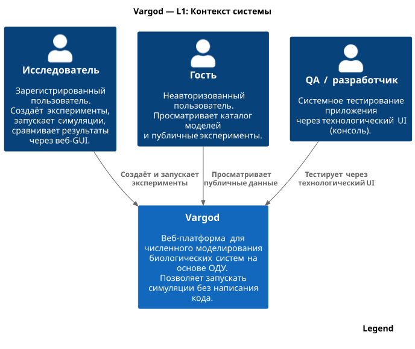
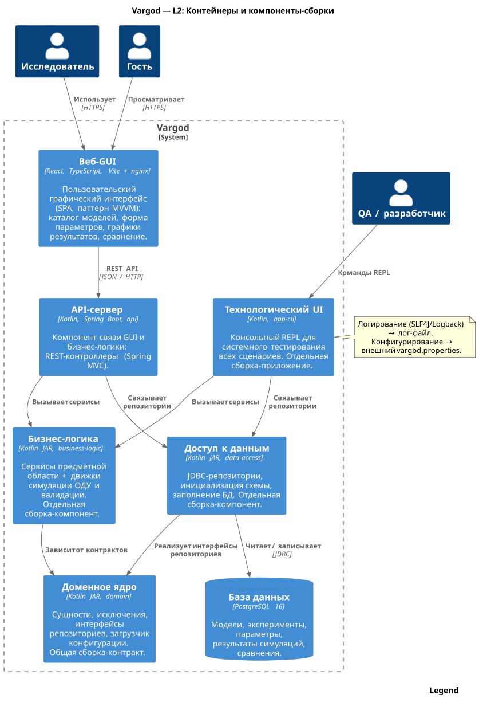
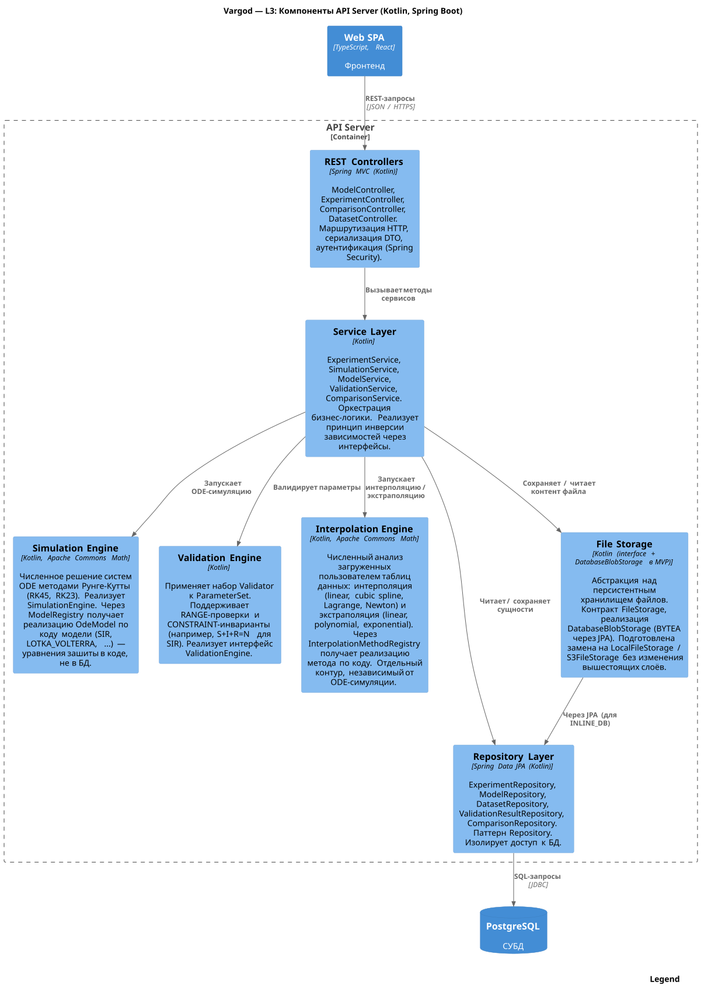
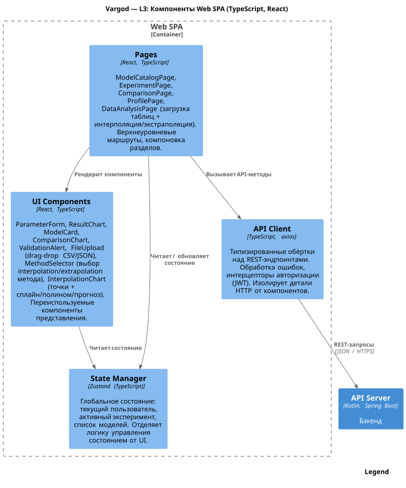
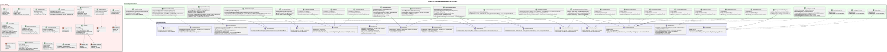
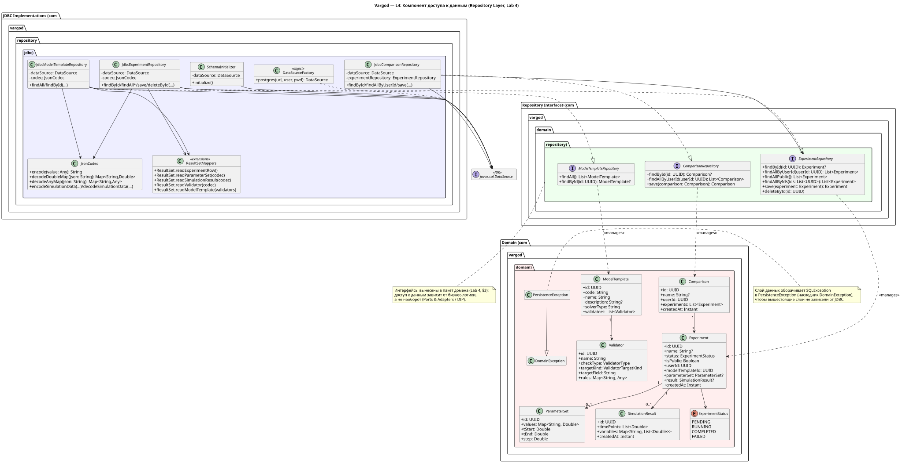
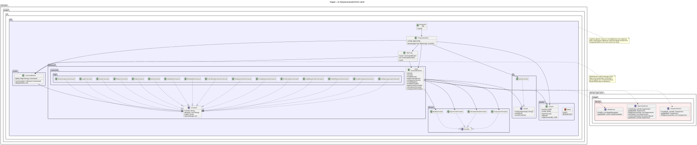
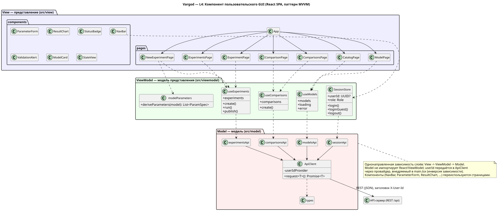

# Architecture

Vargod — Gradle multi-project на Kotlin (5 backend-модулей) и отдельный React-фронт.
Архитектурный стиль — слоистый, инверсия зависимостей через интерфейсы в `domain`.

## Модули

```
                ┌──────────────────────┐
                │      frontend        │  React + TS + Vite (SPA)
                └──────────┬───────────┘
                           │ HTTPS (REST + JWT Bearer)
                ┌──────────▼───────────┐
                │         api          │  Spring Boot 3.3 + Security + springdoc
                └──────────┬───────────┘
                ┌──────────▼───────────┐
                │    business-logic    │  сервисы, ODE-движок, валидация
                └──────────┬───────────┘
                ┌──────────▼───────────┐
                │     data-access      │  JDBC + Flyway + DataSeeder
                └──────────┬───────────┘
                ┌──────────▼───────────┐
                │       domain         │  типы, исключения, интерфейсы репозиториев
                └──────────────────────┘
                           ▲
                ┌──────────┴───────────┐
                │       app-cli        │  CLI поверх business-logic + data-access
                └──────────────────────┘
```

Граф зависимостей в Gradle (`api/build.gradle.kts`, `app-cli/build.gradle.kts`):

- `domain` ← без внешних модулей.
- `data-access` ← `domain`.
- `business-logic` ← `domain`.
- `api` ← `domain`, `data-access`, `business-logic`.
- `app-cli` ← `domain`, `data-access`, `business-logic`.

`api` и `app-cli` — два равноправных интерфейса к одной бизнес-логике.

## Краткое описание модулей

### `domain`
Доменные типы: `User`, `Role`, `Experiment`, `ModelTemplate`, `Validator`, `Comparison`, `SimulationResult`, `AuditEntry`, `ValidationResult`. Кастомные исключения (`NotFoundException`, `AuthorizationException`, `ValidationException`, `PersistenceException`). Интерфейсы репозиториев. Цель — нулевые зависимости, читается без Spring/JDBC контекста.

### `business-logic`
Сервисный слой (`*Service` + `impl/*ServiceImpl`): аутентификация (`AuthService`), эксперименты (`ExperimentService`), сравнения (`ComparisonService`), модели (`ModelService`), admin (`AdminUserService`, `ValidatorAdminService`, `AuditLogService`).

Движок:
- `engine.ode.*` — реализации `OdeModel` для 7 моделей + `MapModelRegistry` (lookup по коду).
- `engine.OdeSimulationEngine` — интегратор Dormand-Prince 5(4) поверх Apache Commons Math с настраиваемыми maxStep / relTol / absTol.
- `engine.validation.*` — реестр правил (`RANGE`, `ORDERED`, `SUM_EQUALS_VALUE`, `SUM_EQUALS_FIELD`) c paramsSchema для динамической формы.

### `data-access`
JDBC-репозитории (`*RepositoryJdbc`), миграции Flyway (`db/migration/V1__init.sql` … `V7__model_template_solver_hints.sql`), `SchemaInitializer` с `baselineOnMigrate(true)` для накатывания на dev-БД без истории, `DataSeeder` для эталонных моделей. JSON-сериализация параметров — через `JsonCodec` (Jackson).

### `api`
Spring Boot 3.3.5 + Spring Security 6 + `oauth2-resource-server` (JWT HS256 через Nimbus). Контроллеры:
- `AuthController` — register/login/me.
- `ExperimentController`, `ComparisonController`, `ModelController` — основная бизнес-функциональность.
- `web/admin/Admin*Controller` — 5 admin-эндпоинтов (users, validators, audit, models, experiments).

Конфигурация: `SecurityConfig` (CSRF off, stateless, CORS из env), `WebConfig` (`CurrentUserArgumentResolver`), `OpenApiConfig` (springdoc-openapi с bearer-auth схемой), `AdminBootstrap` (создание первого ADMIN при пустой таблице).

### `app-cli`
Текстовый CLI с собственной картой команд для скриптовых сценариев и smoke-тестов. Использует те же сервисы, что и API, через `Composition` (ручной DI без Spring).

### `frontend`
React 18 + TypeScript + Vite + Tailwind + shadcn/ui. Состояние: TanStack Query (server state), Zustand (client state), React Hook Form + Zod (валидация форм). Графики — Recharts. Динамическая форма валидатора в admin-панели строится из `paramsSchema`, полученной с `/api/admin/validator-types`.

## C4-диаграммы

### L1 — System context



### L2 — Containers



### L3 — Components (backend)



### L3 — Components (frontend)



### L4 — Code: сервисный слой



### L4 — Code: репозиторный слой



### L4 — Code: CLI



### L4 — Code: GUI



## Сиквенс-диаграммы

- Проведение эксперимента — [`img/seq_experiment.svg`](../img/seq_experiment.svg).
- Сравнение экспериментов — [`img/seq_comparison.svg`](../img/seq_comparison.svg).

## BPMN

- Бизнес-процесс эксперимента — [`img/diagram_exper.svg`](../img/diagram_exper.svg).
- Бизнес-процесс сравнения — [`img/diagram_compar.svg`](../img/diagram_compar.svg).

## Use-case и ER

- Use-case — [`img/usecase.svg`](../img/usecase.svg).
- ER-диаграмма — [`img/er.drawio.svg`](../img/er.drawio.svg) (исходник в `diagrams/er.drawio`).
- Логическая схема — [`diagrams/schema.dbml`](../diagrams/schema.dbml).

## Конфигурация и развёртывание

- `.env.example` — единый набор переменных (DB, JWT, ADMIN bootstrap, CORS).
- `docker-compose.yml` — 4 сервиса: `db` (postgres:16), `api`, `cli`, `frontend`. Healthcheck на `db`, `api` стартует только после `service_healthy`.
- Логи API пишутся и в stdout, и в файл `logs/vargod-api.log` (volume в `docker-compose.yml`).
- CI: `.github/workflows/ci.yml` — `./gradlew build` на pull request.

## Ключевые архитектурные решения

| Решение | Где | Почему |
| --- | --- | --- |
| Слоистая архитектура с `domain` без зависимостей | `domain` | Тестируемость, ясные границы. |
| JWT HS256 в `Authorization: Bearer` (P1) | `api` | Stateless REST, не нужны session cookies. Заменил небезопасный `X-User-Id`. |
| Snapshot валидаторов при создании эксперимента (P2) | `business-logic`, `V4__experiment_validator_snapshot.sql` | Воспроизводимость: эксперимент не «протухает» при правке валидаторов. |
| `solverHints` на уровне `ModelTemplate` (P4) | `business-logic`, `V7__model_template_solver_hints.sql` | Жёсткие системы (HH) требуют свой relTol/absTol/maxStep. |
| `paramsSchema` для динамической формы валидатора (P2) | `engine.validation.RuleParamsSchema` | Один источник правды: бэкенд декларирует поля, фронт рендерит форму. |
| `springdoc-openapi` (P7) | `OpenApiConfig` | Swagger UI без ручного поддержания YAML-спеки. |
